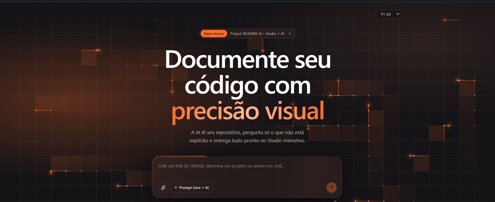

<div align="center">

# ✨ Project README AI

**Gere `README.md` profissionais para qualquer repositório analisando o código real com Inteligência Artificial.**


<br />
<br />



</div>

---

## 🎯 Sobre o Projeto

Escrever um bom `README.md` costuma ficar para depois — ou vira um texto genérico que não reflete a arquitetura real do projeto.

O **Project README AI** resolve isso em um fluxo guiado de 3 passos:
1. **Escaneia o repositório:** lê metadados, árvore de diretórios, manifestos (`package.json`, `pyproject.toml`, `Cargo.toml`, `go.mod`, `Dockerfile`, `.env.example`) e arquivos de entrada do código-fonte.
2. **Identifica o que falta:** a IA extrai linguagens, frameworks, ferramentas e scripts sozinha e faz **apenas perguntas objetivas sobre o que não está explícito no código** (objetivo de negócio, demo, variáveis não documentadas).
3. **Gera & edita visualmente:** cria seções estruturadas com badges automáticas, tabelas de scripts/variáveis de ambiente e preview em tempo real estilo GitHub — pronto para copiar ou baixar como `README.md`.

> 💡 Se o repositório já possuir um `README.md`, o agente preserva as informações válidas e aprimora a apresentação visual e as seções faltantes.

---

## ✨ Funcionalidades

- 🔍 **Scanner inteligente de repositórios GitHub** com filtragem de ruído (`node_modules`, `.next`, `dist`, locks)
- 🤖 **Análise com AI** com fallback automático entre modelos e preferência IPv4 para alta disponibilidade
- 🧠 **Modo Heurístico integrado** como fallback automático caso não haja chave de IA configurada
- 🌐 **Geração bilíngue (`Português BR` e `English`)** com tradução completa de títulos, tabelas e comentários
- 🎨 **Editor por seções + Preview GitHub ao vivo** (`react-markdown`, `remark-gfm`, `rehype-raw`)
- 🔒 **Chaves de API 100% no servidor (`.env`)** — nenhuma credencial é exposta ou solicitada no navegador

---

## 🛠️ Arquitetura do Projeto

```text
src/
├── app/
│   ├── api/
│   │   ├── scan/route.ts         # Escaneia o repo no GitHub e executa análise + perguntas
│   │   └── generate/route.ts     # Gera seções estruturadas do README.md
│   ├── globals.css               # Estilos globais e tema de preview Markdown
│   ├── layout.tsx                # Layout raiz
│   └── page.tsx                  # Página principal
├── components/
│   └── readme-workbench.tsx      # Interface guiada em 3 etapas + editor e preview
├── lib/
│   ├── ai/
│   │   ├── client.ts             # Cliente AI com timeout, IPv4-first e fallback de modelos
│   │   ├── analyzer.ts           # Análise de stack e geração de perguntas
│   │   └── generator.ts          # Geração e melhoria visual do README.md
│   ├── github/
│   │   └── scanner.ts            # Leitura da árvore e arquivos-chave via GitHub API
│   ├── badges.ts                 # Mapeamento automático de badges Shields.io
│   └── __tests__/                # Testes unitários (Vitest)
└── types/
    └── readme.ts                 # Tipos compartilhados
```

---

## 🚀 Como Rodar Localmente

### Pré-requisitos
- **Node.js** >= 20
- **pnpm** >= 10

### Instalação

```bash
# Clone o repositório
git clone https://github.com/dev-mizael-nascimento/Project-README-AI.git
cd Project-README-AI

# Instale as dependências
pnpm install

# Configure as variáveis de ambiente
cp .env.example .env
```

Edite o `.env` e adicione sua chave do Google AI Studio:

```env
GEMINI_API_KEY=sua_chave_aqui
GITHUB_TOKEN=opcional_para_aumentar_limite_da_api_github
```

Inicie o servidor de desenvolvimento:

```bash
pnpm dev
```

Acesse **`http://localhost:3000`** no navegador.

---

## 📜 Scripts Disponíveis

| Script | Comando | Descrição |
| --- | --- | --- |
| `dev` | `pnpm dev` | Inicia o servidor de desenvolvimento Next.js (Turbopack) |
| `build` | `pnpm build` | Compila a aplicação e verifica tipos TypeScript para produção |
| `start` | `pnpm start` | Inicia o servidor em modo produção |
| `test` | `pnpm test` | Executa a suíte de testes unitários com Vitest |

---

## 🤝 Como Contribuir (Open Source)

Contribuições são muito bem-vindas! Se você quiser adicionar suporte a novos provedores de IA, upload de pastas locais, novos templates visuais ou mais badges:

1. Faça um **Fork** deste repositório
2. Crie uma branch para sua feature ou correção: `git checkout -b feat/minha-contribuicao`
3. Rode os testes (`pnpm test`) e o build (`pnpm build`) para garantir que está tudo funcionando
4. Faça o commit e envie (`git push origin feat/minha-contribuicao`)
5. Abra um **Pull Request** explicando sua melhoria

---

## 🙏 Inspirações e Créditos

Este projeto nasceu inspirado no excelente [**profile-readme-generator**](https://github.com/maurodesouza/profile-readme-generator) criado por **Mauro de Souza**, expandindo a ideia de geração visual de READMEs para **repositórios de código completos** com apoio de Inteligência Artificial.

---

## 📄 Licença

Distribuído sob a licença **MIT**. Veja o arquivo [LICENSE](LICENSE) para mais detalhes.
