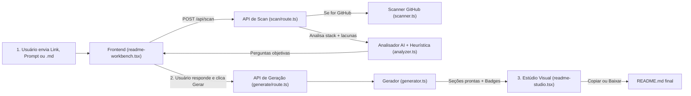

# 📘 Guia Completo do Projeto — Project README AI (Para Iniciantes)

Bem-vindo(a)! Este guia foi escrito especialmente para **quem está começando na programação** e quer entender, peça por peça, como o **Project README AI** funciona por dentro.

Em vez de apenas usar termos técnicos difíceis, aqui você vai ver **o que cada arquivo faz**, **como a tela conversa com o servidor** e **como a Inteligência Artificial trabalha junto com regras de código** para gerar um `README.md` profissional.

---

## 🧭 1. O que este projeto faz, em uma frase?

Você entrega um **link do GitHub**, um **texto descrevendo sua ideia** ou um **arquivo `.md` do seu computador**, e o sistema analisa o projeto, faz poucas perguntas sobre o que não dá para adivinhar só olhando o código e abre um **Estúdio visual** para você editar e baixar o seu `README.md`.

---

## 🏗️ 2. Visão Geral da Arquitetura (Frontend + Backend)

O projeto usa **Next.js** (um framework baseado em **React** e **TypeScript**). Uma grande vantagem do Next.js é que ele junta duas partes no mesmo projeto:

1. **Frontend (o que você vê e clica no navegador):**
   - Fica principalmente em `src/app/page.tsx` e `src/components/`.
   - É onde estão os formulários, animações, modais de progresso, diagramas e o editor visual do `README.md`.
2. **Backend / Rotas de API (o que roda escondido no servidor):**
   - Fica em `src/app/api/`.
   - É quem conversa com a **API do GitHub** e com a **Inteligência Artificial**, mantendo a sua chave secreta (`GEMINI_API_KEY`) protegida no arquivo `.env` do servidor (ela nunca vai para o navegador do usuário!).

### Fluxo resumido de ponta a ponta



---

## 📂 3. Mapa Completo de Pastas e Arquivos

Abaixo está o papel exato de cada arquivo do projeto:

```text
project readme/
├── docs/
│   ├── preview.png                      # Print da tela exibido no README principal
│   └── GUIA_DO_PROJETO.md               # Este guia didático para iniciantes
├── public/
│   └── icons/                           # 16 ícones SVG usados pelos diagramas da Seção 2
├── src/
│   ├── app/
│   │   ├── page.tsx                     # Porta de entrada da página inicial (/)
│   │   ├── layout.tsx                   # Moldura HTML global + importação dos estilos
│   │   ├── globals.css                  # Estilos globais (Tailwind CSS + tema escuro/Markdown)
│   │   ├── diagrams.css                 # Regras visuais dos diagramas interativos
│   │   └── api/
│   │       ├── scan/route.ts            # Endpoint POST /api/scan (lê entrada e analisa)
│   │       └── generate/route.ts        # Endpoint POST /api/generate (cria as seções do README)
│   ├── components/
│   │   ├── readme-workbench.tsx         # Orquestrador das 3 etapas na tela
│   │   ├── grid-pulse-bg.tsx            # Fundo animado em Canvas (grade com pulsos laranja)
│   │   ├── edge-glow-box.tsx            # Caixa estilo Glass com brilho que segue o mouse
│   │   ├── scan-progress-modal.tsx      # Popup de progresso durante a leitura do projeto
│   │   ├── architecture-section.tsx     # Seção 2 da landing page com 4 diagramas livres
│   │   └── readme-studio.tsx            # Editor visual por seções + Preview estilo GitHub
│   ├── lib/
│   │   ├── github/
│   │   │   └── scanner.ts               # Busca arquivos, árvore e linguagens no GitHub
│   │   ├── ai/
│   │   │   ├── client.ts                # Conexão com a API de IA + retry/fallback de modelos
│   │   │   ├── analyzer.ts              # Descobre linguagens/ferramentas e gera perguntas
│   │   │   └── generator.ts             # Monta as seções do README.md
│   │   ├── badges.ts                    # Gera badges (Shields.io) e busca ícones de tecnologias
│   │   ├── input-detector.ts            # Descobre se o texto digitado é link do GitHub ou prompt
│   │   ├── markdown-splitter.ts         # Quebra um .md local em blocos editáveis por título
│   │   ├── studio-blocks.ts             # Modelos prontos de seções extras no Studio
│   │   ├── tech-serializer.ts           # Converte a lista de ícones de tecnologias em Markdown
│   │   ├── diagram.js                   # Motor leve em JavaScript que desenha e anima os diagramas
│   │   └── __tests__/
│   │       └── scanner-and-analyzer.test.ts # Testes automatizados (Vitest)
│   ├── resources/
│   │   └── tech_icons.ts                # Catálogo completo de ícones e badges de tecnologias
│   └── types/
│       ├── readme.ts                    # "Contratos" TypeScript dos dados de scan, análise e seções
│       └── icon.ts                      # Tipos TypeScript para o catálogo de ícones
├── .env.example                         # Modelo das variáveis de ambiente necessárias
├── package.json                         # Lista de dependências e scripts (dev, build, test)
└── vitest.config.ts                     # Configuração dos testes automatizados
```

---

## 🔍 4. Entendendo Cada Parte em Detalhes

### Parte A — A Tela Inicial e as 3 Etapas (`src/components/`)

#### 1. `src/app/page.tsx` e `src/app/layout.tsx`
- **`layout.tsx`** define o HTML base (`<html lang="pt-BR" className="dark">`), o título da aba e carrega `globals.css` e `diagrams.css`.
- **`page.tsx`** simplesmente renderiza o componente `<ReadmeWorkbench />`.

#### 2. `src/components/readme-workbench.tsx` (O Cérebro da Interface)
Esse componente controla em qual etapa (`step`) o usuário está:
- **`step === 'input'` (Etapa 1 — Entrada):**
  - Mostra a headline animada (`fx-headline`) e a caixa principal (`EdgeGlowBox`).
  - Aceita **3 formatos de entrada**:
    1. **Link do GitHub** (ex.: `https://github.com/usuario/projeto` ou `usuario/projeto`).
    2. **Prompt livre** (a pessoa descreve com suas palavras o que o projeto faz; se digitar algo fora do assunto — como uma pergunta aleatória —, a API retorna `offTopicReply` e aparece um **popup amigável** explicando o foco da ferramenta).
    3. **Arquivo `.md` local** (upload pelo botão de clipe ou arrastando/selecionando um `.md` do computador — nesse caso, o arquivo já pode ir direto para o estúdio usando `splitMarkdownIntoSections`, ou ser analisado).
  - Permite escolher o idioma de saída do README (`Português BR` ou `English`).
  - Enquanto o servidor trabalha, abre o **`ScanProgressModal`** (`scan-progress-modal.tsx`) mostrando o avanço visual.
- **`step === 'questions'` (Etapa 2 — Perguntas Cirúrgicas):**
  - Exibe um resumo do que já foi encontrado automaticamente (linguagens, frameworks, ferramentas e variáveis de ambiente) + de **0 a 4 perguntas** sobre o que *não* está óbvio no código.
- **`step === 'editor'` (Etapa 3 — Estúdio Visual):**
  - Abre o `<ReadmeStudio />` (`readme-studio.tsx`), onde você pode:
    - Reordenar, ativar/desativar, editar ou excluir seções;
    - Adicionar blocos prontos (`STUDIO_BLOCK_PRESETS` de `studio-blocks.ts`);
    - Escolher e alinhar ícones de tecnologias com busca em tempo real no catálogo (`tech_icons.ts`);
    - Ver o **Preview ao vivo** idêntico ao GitHub (`react-markdown`, `remark-gfm`, `rehype-raw`);
    - Copiar o Markdown final ou baixar o arquivo `README.md`.

#### 3. Visual e Seção 2 (`grid-pulse-bg.tsx`, `edge-glow-box.tsx`, `architecture-section.tsx`)
- **`grid-pulse-bg.tsx`**: desenha um fundo interativo em `<canvas>` com uma grade escura (`#161316`) e pulsos laranja (`#FF6D29`). Tem até botão de pausar/retomar a animação de fundo no canto.
- **`edge-glow-box.tsx`**: implementa o efeito "Glass" com brilho suave nas bordas que acompanha a posição do mouse (`pointermove`).
- **`architecture-section.tsx`**: aparece logo abaixo da primeira dobra quando `step === 'input'`.
  - Começa com uma faixa em degradê transparente para `#110e11` para fazer uma **transição suave** saindo do fundo animado da Seção 1.
  - Renderiza **4 diagramas livres na página** (sem caixas/cards ao redor), usando `src/lib/diagram.js` + `src/app/diagrams.css` e os ícones de `public/icons/`:
    1. `hub` (Entrada flexível)
    2. `fanin` (Varredura inteligente)
    3. `lanes` (Perguntas cirúrgicas)
    4. `timeline` (Estúdio interativo)

---

### Parte B — Como o Sistema Lê um Repositório no GitHub (`src/lib/github/scanner.ts`)

Quando você cola um link do GitHub, o frontend chama `POST /api/scan` (`src/app/api/scan/route.ts`), que detecta o link via `isGitHubRepoInput` (`src/lib/input-detector.ts`) e chama `scanGitHubRepo()`.

Veja o que `scanGitHubRepo()` faz passo a passo:
1. **Quebra a URL (`parseGitHubUrl`)**: transforma `https://github.com/dono/repo` ou `dono/repo` em `{ owner, repo }`.
2. **Busca metadados do repositório**: chama `https://api.github.com/repos/{owner}/{repo}` para pegar branch padrão (`main` ou `master`), descrição, homepage, licença e tópicos.
3. **Busca a árvore de arquivos e as linguagens em paralelo**:
   - `git/trees/{branch}?recursive=1`: lista todos os arquivos do projeto, ignorando pastas pesadas de dependência/build em qualquer nível (`node_modules/`, `.git/`, `.next/`, `dist/`, `venv/`, `.venv/`, `__pycache__/`, etc.).
   - `/repos/{owner}/{repo}/languages`: obtém o mapa oficial de linguagens do GitHub (ex.: `Python`, `HTML`, `CSS`, `JavaScript`, `TypeScript`).
4. **Seleciona e baixa os arquivos-chave (`keyFiles`)**:
   - Dá prioridade máxima a arquivos `.env*` (`.env.example`, `.env.sample`, `.env.template`, `.env.dist`) e manifestos (`package.json`, `requirements.txt`, `pyproject.toml`, `Dockerfile`, `Procfile`, `README.md`, etc.) — **mesmo quando estão dentro de subpastas** (como `backend/requirements.txt` ou `web/.env.example`).
   - Também pega arquivos principais de entrada (`app.py`, `main.py`, `models.py`, `config.py`, `src/app/page.tsx`, etc.).
   - Baixa o conteúdo via `raw.githubusercontent.com` codificando espaços e caracteres especiais da URL (`encodeGitHubPath`).

> **Dica para iniciantes:** Por que o sistema não baixa *todos* os arquivos do repositório? Porque projetos grandes têm milhares de arquivos. Baixar só a lista de caminhos (`tree`) + até 24 arquivos-chave (`keyFiles`) deixa tudo muito rápido e barato para a IA ler!

---

### Parte C — Como Funciona a Análise Inteligente + Fallback (`src/lib/ai/analyzer.ts` e `client.ts`)

Depois que o `scanner.ts` entrega o resumo (`RepoScanSummary`), entra o `analyzeRepository()`:

1. **Análise Heurística de Base (`heuristicAnalyze`)**:
   - Antes mesmo de chamar a IA, o código já aplica regras determinísticas:
     - Lê `scan.languages` (da API do GitHub) e as extensões dos arquivos da árvore (`.py`, `.html`, `.css`, `.js`, `.ts`, `.sql`, `.db`, `.sh`, etc.).
     - Lê todos os `package.json`, `requirements.txt`, `pyproject.toml` e `Pipfile` (inclusive em subpastas) para achar `Next.js`, `React`, `Flask`, `Django`, `FastAPI`, `TailwindCSS`, `SQLAlchemy`, `SQLite`, `Vitest`, `Playwright`, etc.
     - Lê todos os arquivos `.env.*` (inclusive em subpastas) e extrai o nome de cada variável antes do `=`.
     - Se faltar descrição, homepage ou variáveis de ambiente, prepara perguntas específicas para o usuário.
2. **Refinamento com IA (`generateJsonWithGemini` em `client.ts`)**:
   - Se houver uma `GEMINI_API_KEY` configurada no `.env`, o servidor envia a árvore, as linguagens e o conteúdo dos arquivos-chave pedindo um JSON estruturado.
   - O `client.ts` força IPv4 primeiro (`dns.setDefaultResultOrder('ipv4first')` — evita travamentos comuns no Windows), usa timeout de 25s e tenta uma lista de modelos em cascata (`MODEL_CANDIDATES`) caso algum esteja temporariamente sobrecarregado (`429` ou `503`).
   - **Mescla segura (`mergeUnique`)**: o resultado da IA é combinado com a análise heurística de base, garantindo que nenhuma linguagem detectada pelo GitHub nem nenhuma variável do `.env.example` desapareça.
   - **Se não houver chave de IA ou a API falhar:** o sistema não quebra! Ele cai automaticamente no modo heurístico (`mode: 'heuristic'`) e continua funcionando.

---

### Parte D — Como o README é Gerado (`src/lib/ai/generator.ts` e `badges.ts`)

Quando o usuário responde às perguntas na Etapa 2 e clica em **"Gerar e abrir no Studio"**, o frontend envia `scan`, `analysis` e `answers` para `POST /api/generate`:

1. **`badges.ts`**: usa o catálogo `src/resources/tech_icons.ts` para transformar tecnologias detectadas (`TypeScript`, `Python`, `Flask`, `Next.js`, etc.) em badges do **Shields.io** ou ícones do **Devicon**.
2. **`generator.ts`**:
   - Com IA: pede um JSON com seções organizadas (`header`, `features`, `stack`, `installation`, `env`, `scripts`, `license`, etc.) já no idioma escolhido (`pt-BR` ou `en`).
   - Sem IA (fallback heurístico `buildHeuristicSections`): monta todas essas seções automaticamente usando regras de código (detectando `pnpm`, `npm` ou `pip install -r requirements.txt` para os comandos de instalação).

---

## 🧪 5. Como Testar e Rodar Localmente

### Pré-requisitos
- **Node.js** (18+) e **pnpm** instalados.

### Passos no terminal

```bash
# 1. Instalar as dependências
pnpm install

# 2. Copiar o arquivo de exemplo de variáveis de ambiente
cp .env.example .env
# (Opcional) Preencha GEMINI_API_KEY e GITHUB_TOKEN no .env

# 3. Rodar o servidor em modo de desenvolvimento
pnpm dev
```

Depois, abra `http://localhost:3000` no navegador.

### Comandos úteis de verificação
- `pnpm test`: executa os testes unitários com **Vitest** (`src/lib/__tests__/scanner-and-analyzer.test.ts`), validando parser de URL, detecção de stack em raiz e subpastas, geração de badges e divisão de Markdown.
- `pnpm build`: compila o projeto inteiro para produção e verifica todos os tipos TypeScript.

---

## 💡 6. Resumo dos Conceitos de Programação que Você Vê Aqui

Se você está estudando programação, este projeto é um ótimo laboratório real de:
- **Separação Frontend / Backend**: o navegador nunca vê segredos do `.env`; ele só faz requisições `POST` para `/api/scan` e `/api/generate`.
- **Tipagem com TypeScript (`src/types/`)**: definir interfaces (`RepoScanSummary`, `AnalysisResult`, `ReadmeSection`) evita erros bobos entre o que o backend envia e o que o frontend espera.
- **Resiliência (Graceful Fallback)**: sistemas reais não podem travar se uma API externa falhar; por isso existe a análise heurística como plano B automático.
- **Testes Automatizados (`Vitest`)**: em vez de testar tudo clicando na mão a cada mudança, os testes garantem em milissegundos que o código continua funcionando.
